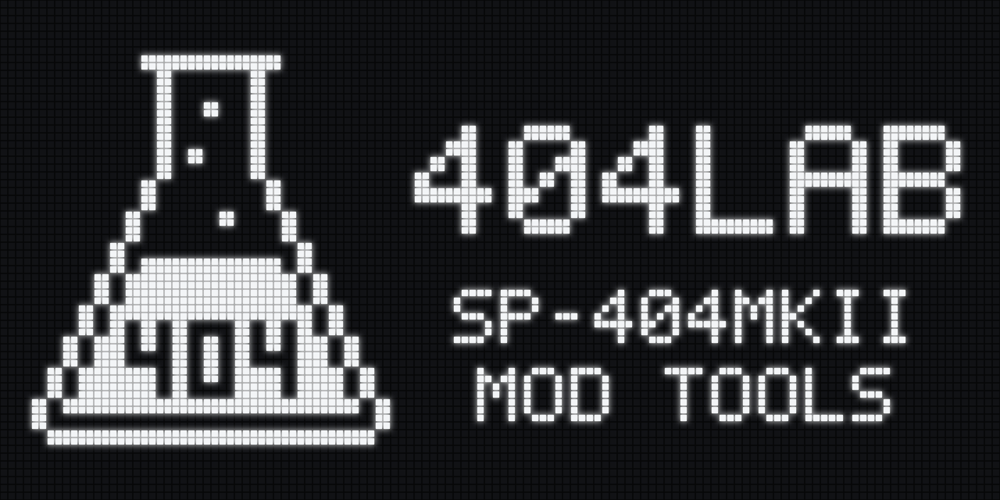
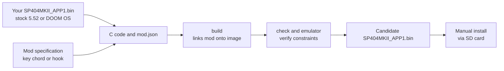

<p align="center"></p>

# 404Lab

**English** | [Русский](README_RU.md)

Open knowledge base with SHA-256 verifiable facts and CLI toolchain (`lab404`) for analyzing, building, and verifying Roland SP-404MKII firmware mods (stock 5.52 and DOOM OS 0.7.x). Designed for both manual firmware reverse-engineering and coding-agent workflows.

Early research toolchain: 404Lab **ships no firmware** (bring your own `SP404MKII_APP1.bin`) and is **not affiliated** with or endorsed by Roland. Example mods are verified on the emulator; one `quick_system` build (DOOM OS 0.7.4) has been tested on a physical **unit**, whereas builds produced through `package` have not been run on hardware. See [Hardware Findings](docs/ON_A_UNIT.md) and [Status](docs/STATUS.md).

## How it works



1. **Supply APP1:** Start from stock `SP404MKII_APP1.bin` (5.52) or a DOOM OS build derived from it; run `identify` to verify the exact image hash.
2. **Write the mod:** Implement C handlers and a `mod.json` manifest using addresses and control bindings queried from the knowledge base (`ask`, `topics`, `gaps`, `check-keys`).
3. **Build:** `build` appends the compiled payload after the base firmware, applies declared hooks/patches, and writes `SP404MKII_APP1.bin` plus `manifest.json` into a new output directory.
4. **Verify:** `check` validates the manifest, flash-size budget (`0x37F000`), and loader safety constraints; Unicorn and DM-404 test code and UI behaviour in emulation.
5. **Install manually:** Copy `SP404MKII_APP1.bin` to the SD card root, verify its SHA-256 against `manifest.json`, and run the standard update (SHIFT at power-on, then VALUE). Reflash the original `SP404MKII_APP1.bin` to revert.

## Capabilities

| Component | Purpose |
|---|---|
| Image tools | Identify firmware hashes, inspect memory maps, read/disassemble bytes, find cross-references, and verify SHA-256 byte facts |
| Builder (`build`) | Compile C payloads with `clang`, resolve declared firmware symbols, apply hooks/patches, and generate isolated candidate directories |
| Verifier (`check`) | Validate candidate bytes against `manifest.json`, target base image, flash limits, and protected loader routines |
| Packaging (`preview`, `approve`, `package`) | Conservative verification route for additive mods: UI comparison on DM-404, approval recording, and `UNIT_CHECKS.md` generation |
| Knowledge base & gaps | Versioned facts (`knowledge/facts/`) with provenance labels and open research questions (`gaps`) |
| Emulation stands | Unicorn (`stand.py`) for instruction-exact function checks; external [DM-404](https://github.com/nickpetty/dm-404) (`emulator.py`) for full-firmware boot and UI replay |

`identify` recognizes stock 3.02–5.52, DOOM OS 0.6–0.7.4, and Tampal builds by hash. Byte-level knowledge checks cover stock 5.52 and DOOM OS 0.7.2–0.7.4; build examples target stock 5.52 and DOOM OS 0.7.3–0.7.4, and `build` accepts only declared, identified base images.

## Documentation

- [Examples and research commands](docs/EXAMPLES.md) — CLI inspection, hook kinds, and source mods (`demo_counter`, `quick_system`, `fault_screen`)
- [Reference documents](docs/SOURCES.md) — Roland manuals, NXP i.MX RT1060 / Arm references, and board component datasheets
- [Hardware hazards and recovery limits](docs/SAFETY.md) — loader erasure risks, protected routines, and file-name safeguards
- [Emulation stands](docs/STAND.md) — Unicorn vs. DM-404 capabilities, GDB debugging, and key-sweep verdicts
- [Status](docs/STATUS.md) — supported firmware matrix, patch kinds, and known limitations
- [Hardware findings](docs/ON_A_UNIT.md) — unit-tested behaviours, engineering pitfalls, and stock 5.52 bugs
- [Contributing](CONTRIBUTING.md) · [Agent project map](AGENTS.md)

## Limitations & Verification

- **Build output is a `candidate`:** Passing `check` or an emulator run is **never proof** that a mod works on a physical `unit`. Real-time audio deadlines, DSP effect sound on the BMC, and SD card behaviour can only be verified on hardware.
- **Evidence labels:** Every fact carries `[HARDWARE]`, `[EMULATOR]`, `[BYTES]`, `[DOC]`, or `[HYPOTHESIS]`. Status `unknown` is never treated as `free` or `pass`.
- **Manual SD installation:** The tool generates `SP404MKII_APP1.bin` for manual installation via SD card. Back up projects and retain a copy of the stock `SP404MKII_APP1.bin` before testing.

## Quick start

Requires Python 3.10+ and `clang` for `build`.

| Feature | Linux | macOS | Windows |
|---|---|---|---|
| Knowledge base (`ask`, `topics`, `gaps`, `check-keys`) | yes | yes | yes |
| Image tools (`identify`, `map`, `read`, `dis`, `xrefs`, `find`, `verify-knowledge`) | yes | yes | yes |
| `build` and `check` (requires `clang`) | yes | expected | expected |
| Function stand (Unicorn) | yes | expected | expected |
| Full-firmware stand (DM-404: `preview`, `package`, `sweep`) | yes | untested | WSL only |
| CI coverage | quick tests | quick tests | quick tests |

```bash
python3 -m venv .venv
source .venv/bin/activate
python -m pip install -r requirements.txt
python -m lab404 doctor
```

On Windows (PowerShell): `py -m venv .venv; .venv\Scripts\Activate.ps1; python -m pip install -r requirements.txt`.

Query the knowledge base and inspect a local firmware image:

```bash
python -m lab404 identify SP404MKII_APP1.bin
python -m lab404 ask "skip" --firmware stock-5.52
python -m lab404 topics
python -m lab404 gaps
python -m lab404 check-keys stock-5.52 sample SHIFT LOOP
python -m lab404 verify-knowledge SP404MKII_APP1.bin
```

Build and verify the minimal `demo_counter` example:

```bash
python -m lab404 build mods/demo_counter SP404MKII_APP1.bin out/demo-1
python -m lab404 check out/demo-1 mods/demo_counter SP404MKII_APP1.bin
```

Preview `quick_system` on DM-404 (requires `tools/setup_dm404.sh`; see [docs/EXAMPLES.md](docs/EXAMPLES.md) for `approve` and `package`):

```bash
python -m lab404 preview mods/quick_system SP404MKII_APP1.bin
```

## Related projects

- [SparkyMK2](https://github.com/TuscanPL/SparkyMK2) — open USB editor/librarian and protocol/format specification
- [404tui](https://github.com/moahbeatlab/404tui) — terminal sample/slice/pattern manager built on SparkyMK2's protocol work

## Tests

```bash
python tools/run_tests.py --quick
python tools/run_tests.py
```

`--quick` skips tests that boot DM-404; tests requiring firmware images or DM-404 skip automatically when inputs are absent.

## License

- **Licence:** [MIT](LICENSE) for 404Lab code and original text. It grants no rights to Roland firmware, third-party mods, or DM-404. See [docs/LEGAL_NOTES.md](docs/LEGAL_NOTES.md).
