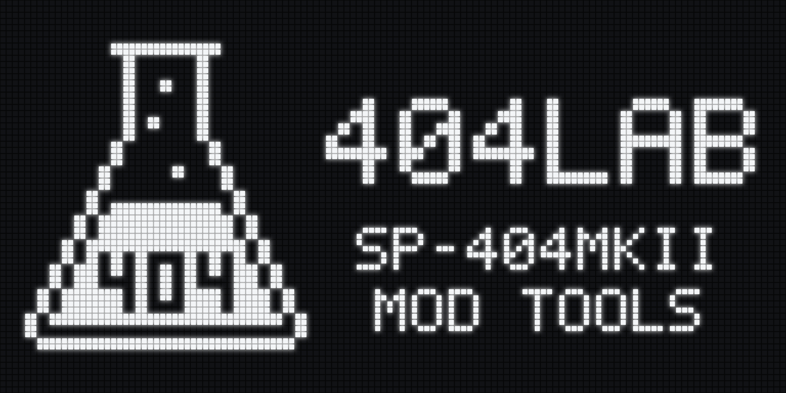
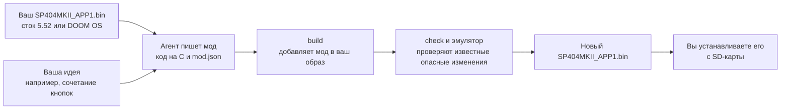

# 404Lab

[English](https://github.com/jjjadeRRR/404Lab) | **Русский**

Открытые исследования и инструменты для моддинга Roland SP-404MKII, готовые для работы с ИИ-агентами. Вы даёте свой файл прошивки и идею, а получаете новый файл прошивки с вашим модом.

В одном репозитории две части:

- **Исследовательская база.** Всё, что известно об устройстве, стоковой прошивке и других модах, в виде проверяемых фактов. У каждого факта указано, откуда он: прочитан в байтах конкретного образа, увиден в эмуляторе, получен на приборе, взят из документа — или это пока гипотеза. Факты о байтах можно перепроверить на своём образе одной командой.
- **Мастерская для создания модов — с ИИ-агентом или вручную.** Агент спрашивает базу о том, что ему нужно (`ask`, `topics`, `gaps`), а не читает всё подряд. Инструменты определяют ваш образ, собирают на нём мод, привязывают результат к точной основе и исходникам, запускают его в эмуляторе и отклоняют известные опасные изменения. Три примера показывают сборку и проверку разных модов.

Проект для авторов модов, исследователей и владельцев, которые хотят изменить свой инструмент — сами или вместе с любым агентом для программирования. Обязательного сценария для агента нет: метод зависит от вопроса и эксперимента.

**Ранняя стадия.** Поддержка прошивок и видов модификаций ограничена. Примеры проверялись на эмуляторе. Одна сборка этих инструментов (`quick_system` на DOOM OS 0.7.4) прошла свои проверки на одном приборе, один раз; через `package` на прибор ещё ничего не попадало. Большинство сведений об устройстве получено на одном приборе. Возможности и ограничения — в [STATUS.md](docs/STATUS.md). Что уже сделано этими методами и работает на приборе — в [ON_A_UNIT.md](docs/ON_A_UNIT.md): собственный мод автора проекта даёт эффект на каждый пэд, измеритель выхода, совпадающий с DAW, mute group на 32 пэда, экран сбоя и другое.

Проект неофициальный и не связан с Roland. Прошивок здесь нет: для работы с образом нужен ваш собственный файл.

## Как это работает

1. **Свой APP1.** Файл `SP404MKII_APP1.bin` из обновления Roland 5.52 или сборка DOOM OS на его основе. Прошивок в репозитории нет; какая у вас, подскажет `identify`.
2. **Идея.** Опишите обычными словами агенту для программирования (Claude Code, Codex или другому) или напишите мод сами. Агент находит в базе знаний нужные адреса и свободные кнопки и пишет небольшой мод: код на C и `mod.json`, где сказано, куда он встраивается.
3. **Сборка.** `build` добавляет мод в ваш образ. Прошивка остаётся как была, код мода дописывается после неё, а несколько заявленных байтов меняются, чтобы прошивка его вызывала. Новый файл ложится в новую папку вместе с `manifest.json`, который привязывает его к вашему образу и исходникам.
4. **Проверка.** `check` убеждается, что больше ничего не изменилось, код, способный стереть загрузчик, не тронут, а файл помещается во флеш. Эмулятор может запустить прошивку, нажать кнопки и сравнить экраны с оригиналом.
5. **Установка — ваша.** Скопируйте новый `SP404MKII_APP1.bin` в корень SD-карты, сверьте его хеш с `manifest.json` и обновитесь обычным способом (SHIFT при включении, затем VALUE). Вернуться можно, обновившись своим исходным файлом.

Результат — кандидат: проверки и эмулятор не доказывают, что мод работает на приборе. Подробнее — в разделе [«Границы»](#границы).

## Что можно использовать

- **База знаний:** аппаратная часть, функции прошивки, адреса, управление и сведения о сторонних модах. У записей есть источники, область применимости и статус достоверности.
- **Инструменты:** определение APP1, чтение и анализ образа, проверки мест врезки, сборка и сравнение изменений.
- **Стенды:** Unicorn для отдельных функций и внешний DM-404 для запуска целой прошивки. Их возможности различаются и описаны отдельно.
- **Примеры:** `demo_counter` показывает небольшую врезку, `quick_system` — сочетание клавиш для открытия штатного экрана, `fault_screen` — экран сбоя: вместо зависшей картинки он показывает, какая инструкция упала.
- **Открытые вопросы:** список того, чего проект пока не знает и что можно исследовать дальше.

`identify` узнаёт по хешу сток 3.02–5.52, DOOM OS 0.6–0.7.4 и сборки Tampal. Байтовые проверки базы знаний есть для стока 5.52 и DOOM OS 0.7.2, 0.7.3 и 0.7.4; примеры сборки рассчитаны на сток 5.52 и DOOM OS 0.7.3 и 0.7.4 (на 0.7.4 одна сборка была на приборе). Наличие документации о прошивке не означает, что сборщик поддерживает её. Поддержка сборки не означает проверку на настоящем приборе.

## С чего начать

Установка и команды — в [английском README](https://github.com/jjjadeRRR/404Lab#readme), это главная страница проекта на GitHub. Там же таблица, что работает на какой системе: база знаний и инструменты для образов — на Linux, macOS и Windows; полный эмулятор DM-404 — на Linux, на Windows через WSL.

- [Примеры и исследовательские команды](docs/EXAMPLES.md).
- [Первоисточники для исследований](docs/SOURCES.md) — руководства Roland, справочники NXP и Arm, даташиты компонентов.
- [Исследование звукового чипа](knowledge/notes/app0.md) — Compressor 2, который работает в DEEPCUT на реальном SP, скрытый Sub Sonic и результаты разбора APP0, DSP и USB.
- [Опасные операции и ограничения восстановления](docs/SAFETY.md).
- [Что проверяют стенды](docs/STAND.md).
- [Как добавить находку, поправку или результат со своего прибора](CONTRIBUTING.md). Вопросы и предложения — через issues и pull requests; прошивки, дампы и сэмплы не прикладывайте.
- [Короткая карта проекта для агента](AGENTS.md).

Можно изучать файлы, писать локальные прототипы и проверять гипотезы без согласования интерфейса. Команды `preview`, `approve` и `package` остаются отдельным, более строгим способом подготовить пакет для совместимых дополнений. Их условия не распространяются на любое исследование.

## Границы

Изменять существующее поведение — допустимая цель мода. Важно описать намеренное изменение и проверить побочные эффекты. Текущий `package` не умеет проверять произвольные замены штатного поведения.

Известные пути стирания загрузчика, опасные служебные файлы и запись APP0 требуют отдельного отношения: обычные эксперименты с модами их не используют. Защиты в инструментах сохранены. Чтение и исследование APP0/BMC остаются полезным направлением; возможность восстановления после записи не считается доказанной.

Жёстких правил немного, и у каждого записана причина: безопасность прибора, никаких чужих материалов, честные метки доказательств ([AGENTS.md](AGENTS.md)). Всё остальное — факты, тесты, правила инструментов — сделано предыдущими агентами и может быть исправлено с доказательствами. Слепо следовать этому не нужно.

Результат теста на эмуляторе не доказывает работу на приборе. `unknown` означает отсутствие подтверждения. Прошивку своего устройства выполняет владелец.

## Права

Собственный код и текст — под [MIT](LICENSE). Прошивки, дампы и чужие материалы в репозиторий не входят. Примеры распространяются исходным кодом. Подробнее — [LEGAL_NOTES.md](docs/LEGAL_NOTES.md).
