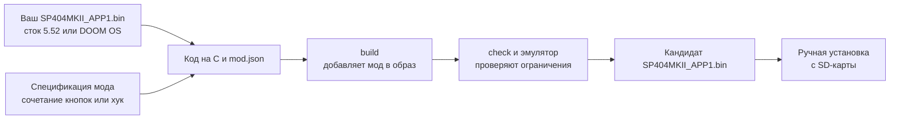

<p align="center"></p>

# 404Lab

[English](README.md) | **Русский**

Открытая база знаний с проверяемыми по SHA-256 фактами и CLI-инструментарий (`lab404`) для анализа, сборки и проверки модов прошивки Roland SP-404MKII (сток 5.52 и DOOM OS 0.7.x). Подходит как для ручного реверс-инжиниринга, так и для работы с coding-агентами.

Ранний исследовательский инструмент: 404Lab **не распространяет прошивки** (нужен собственный `SP404MKII_APP1.bin`) и **не связан** с Roland. Примеры модов проверены в эмуляторе; одна сборка `quick_system` (DOOM OS 0.7.4) проверена на физическом устройстве, тогда как сборки через `package` на реальном железе не запускались. Подробнее — в [результатах на устройстве](docs/ON_A_UNIT.md) и [статусе проекта](docs/STATUS.md).

## Как это работает



1. **Подготовьте APP1:** возьмите стоковый `SP404MKII_APP1.bin` (5.52) или сборку DOOM OS на его основе; `identify` определит точный хеш образа.
2. **Опишите мод:** напишите обработчики на C и манифест `mod.json`, опираясь на адреса и занятость клавиш из базы знаний (`ask`, `topics`, `gaps`, `check-keys`).
3. **Соберите:** `build` дописывает скомпилированный код после базовой прошивки, применяет объявленные хуки и патчи и сохраняет `SP404MKII_APP1.bin` и `manifest.json` в новую папку.
4. **Проверьте:** `check` сверяет манифест, лимит объёма флеша (`0x37F000`) и защиту загрузчика; стенды Unicorn и DM-404 проверяют код и экранное поведение в эмуляции.
5. **Установите вручную:** скопируйте `SP404MKII_APP1.bin` в корень SD-карты, сверьте SHA-256 с `manifest.json` и выполните штатное обновление (SHIFT при включении, затем VALUE). Для отката прошейте исходный `SP404MKII_APP1.bin`.

## Возможности

| Компонент | Назначение |
|---|---|
| Инструменты образа | Определение хеша прошивки, карта памяти, чтение и дизассемблирование, поиск перекрёстных ссылок, проверка байтовых фактов по SHA-256 |
| Сборщик (`build`) | Компиляция модулей на C через `clang`, разрешение символов прошивки, применение хуков/патчей, изоляция каждой сборки |
| Валидатор (`check`) | Сверка байтов кандидата с `manifest.json`, базовым образом, лимитом флеша и защищёнными процедурами загрузчика |
| Упаковка (`preview`, `approve`, `package`) | Консервативный маршрут для аддитивных модов: сравнение экранов в DM-404, фиксация подтверждения и генерация `UNIT_CHECKS.md` |
| База знаний и пробелы | Версионированные факты (`knowledge/facts/`) с метками доказательности и список открытых вопросов (`gaps`) |
| Эмуляторы | Unicorn (`stand.py`) для точной проверки отдельных функций; внешний [DM-404](https://github.com/nickpetty/dm-404) (`emulator.py`) для загрузки всей прошивки и воспроизведения UI |

`identify` распознаёт по хешу сток 3.02–5.52, DOOM OS 0.6–0.7.4 и сборки Tampal. Байтовые проверки базы знаний покрывают сток 5.52 и DOOM OS 0.7.2–0.7.4; примеры сборки рассчитаны на сток 5.52 и DOOM OS 0.7.3–0.7.4, а `build` принимает только явно поддержанные базовые образы.

## Документация

- [Примеры и исследовательские команды](docs/EXAMPLES.md) — инспекция образов, типы хуков и исходники примеров (`demo_counter`, `quick_system`, `fault_screen`)
- [Первоисточники](docs/SOURCES.md) — руководства Roland, документация NXP i.MX RT1060 / Arm и даташиты компонентов
- [Опасные операции и пределы восстановления](docs/SAFETY.md) — риски потери загрузчика, защищённые адреса и запрещённые имена файлов
- [Стенды эмуляции](docs/STAND.md) — границы Unicorn и DM-404, отладка через GDB и статусы проверки клавиш
- [Статус проекта](docs/STATUS.md) — матрица поддерживаемых прошивок, типы патчей и известные ограничения
- [Наблюдения на устройстве](docs/ON_A_UNIT.md) — проверенные на железе возможности, инженерные ограничения и ошибки стока 5.52
- [Участие в проекте](CONTRIBUTING.md) · [Карта проекта для агентов](AGENTS.md)

## Ограничения и верификация

- **Сборка даёт кандидата:** успешный `check` или прогон в эмуляторе не доказывает корректную работу на реальном устройстве. Тайминги аудиопотока, звук DSP-эффектов на BMC и поведение реальных SD-карт проверяются только на железе.
- **Метки доказательности:** каждый факт помечен как `[HARDWARE]`, `[EMULATOR]`, `[BYTES]`, `[DOC]` или `[HYPOTHESIS]`. Статус `unknown` никогда не трактуется как `free` или `pass`.
- **Ручная прошивка с SD-карты:** инструмент генерирует файл `SP404MKII_APP1.bin` для ручной установки через SD-карту. Перед экспериментами сделайте резервную копию проектов и сохраните стоковый `SP404MKII_APP1.bin`.

## Быстрый старт

Требуются Python 3.10+ и `clang` для `build`. Подробная таблица совместимости ОС, инструкция по настройке окружения (Linux, macOS, Windows/WSL) и примеры команд приведены в [English README](README.md#quick-start).

```bash
python3 -m venv .venv
source .venv/bin/activate
python -m pip install -r requirements.txt
python -m lab404 doctor
```

Базовые запросы и сборка минимального примера:

```bash
python -m lab404 identify SP404MKII_APP1.bin
python -m lab404 verify-knowledge SP404MKII_APP1.bin
python -m lab404 build mods/demo_counter SP404MKII_APP1.bin out/demo-1
python -m lab404 check out/demo-1 mods/demo_counter SP404MKII_APP1.bin
```

## Связанные проекты

- [SparkyMK2](https://github.com/TuscanPL/SparkyMK2) — открытый USB-редактор/библиотекарь и спецификация протокола и форматов файлов
- [404tui](https://github.com/moahbeatlab/404tui) — консольный менеджер сэмплов, слайсов и паттернов на базе протокола SparkyMK2

## Тесты

```bash
python tools/run_tests.py --quick
python tools/run_tests.py
```

Флаг `--quick` пропускает тесты, запускающие эмулятор DM-404; тесты, требующие локальных образов прошивки или DM-404, пропускаются при их отсутствии.

## Лицензия

- **Лицензия:** [MIT](LICENSE) распространяется только на код и тексты 404Lab и не даёт прав на прошивки Roland, сторонние моды или DM-404. Подробнее — в [docs/LEGAL_NOTES.md](docs/LEGAL_NOTES.md).
