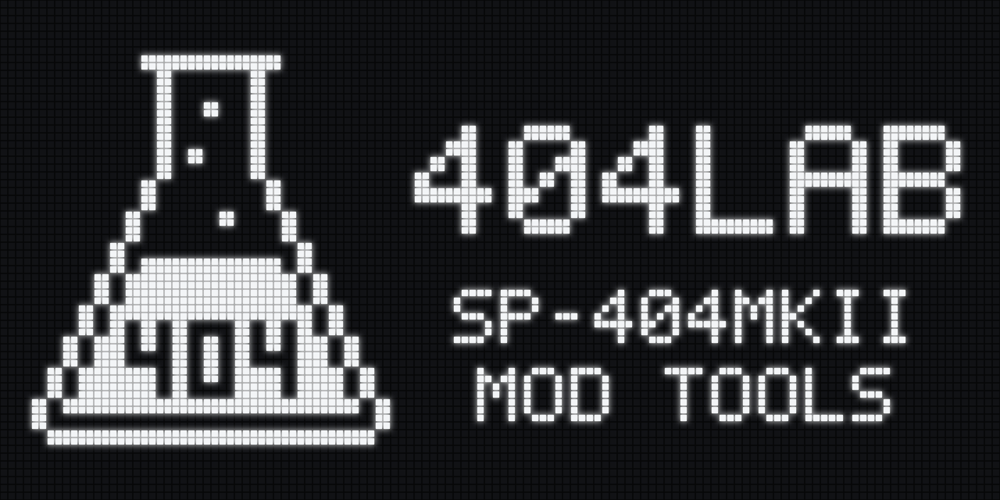

# Agent Evaluation Tasks

`tasks.json` defines a regression suite of clean-environment evaluation scenarios for testing how coding agents use `404Lab` tools and documentation. The scenarios test refusal of unsupported claims, firmware image verification, occupied control detection, and adherence to hardware safety limits.

> **Note:** `tasks.json` retains its original prompt and grading assertions (`must`, `then`, `then_must`) for regression reproducibility. Some assertions reflect the strict `package` approval workflow rather than general exploratory research.

## Running Scenarios in a Clean Clone

1. Create a fresh clone of the repository for each task and provide local firmware inputs without pre-populated build artifacts.
2. Direct the agent to read `AGENTS.md` and run the task prompt (`says` in `tasks.json`).
3. Evaluate the final output and workspace state against the task's `must` criteria defined prior to the run.
4. For multi-turn scenarios containing `then`, supply the follow-up prompt and evaluate against `then_must`.
5. Record any missing documentation or tool gaps uncovered during the run as regression tests.

Evaluation passes grade documentation clarity and tool behaviour in isolation; they do not establish hardware correctness.

## Regression Coverage

Previous runs of this suite drove the following tool and documentation safeguards:

| Gap Identified | Regression Test / Fix |
|---|---|
| Occupied input detection (`HOLD+LOOP` toggling `LOOP` on base) | `unused on the base` check in `package`: `test_a_chord_that_already_does_something_on_the_base_is_refused` |
| Missing install and rollback instructions in `UNIT_CHECKS.md` | Install and rollback sections verified by `test_a_good_task_gives_a_package_bound_to_everything` |
| Missing documented key codes and screen-open primitives | Added `hk.key-event`, `hk.key-codes`, `hk.open-screen` (`WhatAModNeeds`) |
| Overclaiming untested control/screen compatibility | Explicit coverage-boundary rule in `AGENTS.md` |
